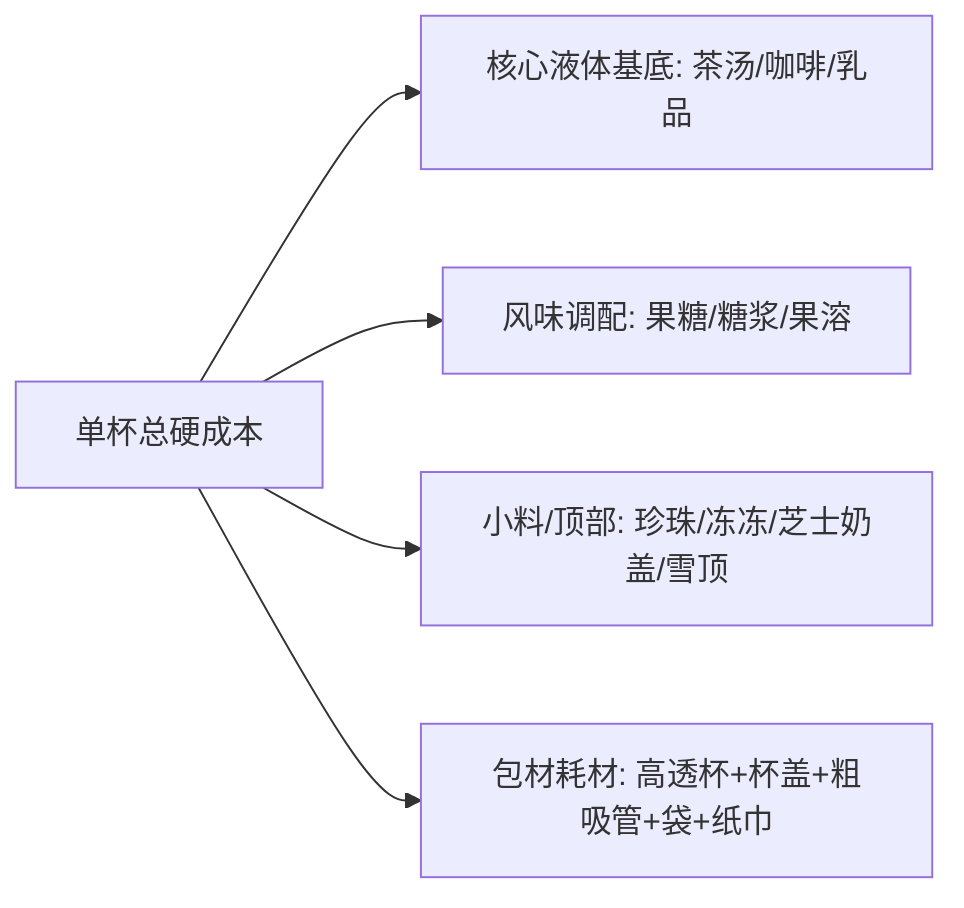

# 饮品单杯成本精算与商业定价模型 (赚钱核心指南)

---

## 一、 饮品单杯综合成本构成 (BOM 结构)

一杯饮品的实际综合出杯成本不等于单纯的茶叶和牛奶，必须包含**三大部分**：

$$\text{单杯硬成本} = \text{主辅料成本 (液体+固体)} + \text{小料加料成本} + \text{全套包材与耗材成本}$$

---

## 二、 典型爆款饮品单杯 BOM 成本拆解表

（以当前主流大宗供应链批发采购均价核算，供精准参考）：

| 爆款单品名称 | 原料核心克重消耗与进价 | 单杯原料成本 (¥) | 全套包材成本 (¥) | 综合单杯成本 (¥) | 建议线下零售价 | 线下理论毛利率 |
| :--- | :--- | :--- | :--- | :--- | :--- | :--- |
| **茉莉初雪轻乳茶** (500ml) | 茉莉绿茶5g (¥0.35) + 鲜奶120ml (¥1.40) + 稀奶油20ml (¥0.65) + 果糖18g (¥0.15) | **¥ 2.55** | ¥ 0.75 | **¥ 3.30** | ¥ 14.00 | **76.4%** |
| **暴打鸭屎香柠檬茶** (700ml) | 单丛茶7g (¥0.55) + 香水柠檬半颗50g (¥0.90) + 冰糖浆40g (¥0.30) | **¥ 1.75** | ¥ 0.85 (超大杯) | **¥ 2.60** | ¥ 13.00 | **80.0%** |
| **经典生椰拿铁** (500ml) | 意式豆19g (¥1.30) + 菲诺生椰乳180ml (¥2.20) + 冰块水质 (¥0.10) | **¥ 3.60** | ¥ 0.80 | **¥ 4.40** | ¥ 16.00 | **72.5%** |
| **多肉芝士葡萄冻冻** (500ml) | 葡萄果溶/原汁 (¥1.60) + 鲜提子肉 (¥0.80) + 奶盖50ml (¥1.20) + 茶底冻冻 (¥0.50) | **¥ 4.10** | ¥ 0.85 | **¥ 4.95** | ¥ 18.00 | **72.5%** |
| **鲜榨橙C美式** (500ml) | 意式豆19g (¥1.30) + NFC纯橙汁160ml (¥1.90) + 橙片与冰 (¥0.30) | **¥ 3.50** | ¥ 0.75 | **¥ 4.25** | ¥ 15.00 | **71.7%** |
| **黑糖珍珠厚乳茶** (500ml) | 黑糖珍珠80g (¥0.60) + 阿萨姆茶底 (¥0.30) + 厚牛乳100ml+鲜奶 (¥1.90) | **¥ 2.80** | ¥ 0.75 | **¥ 3.55** | ¥ 15.00 | **76.3%** |

> **包材耗材明细拆解 (平均 ¥0.75 ~ ¥0.85)**：
> - 90口径注塑高透加厚杯：¥0.35 ~ ¥0.42
> - 防漏防烫开关盖/平盖/冷饮盖：¥0.15 ~ ¥0.18
> - 独立包装三品管/PLA可降解粗吸管：¥0.08 ~ ¥0.12
> - 加厚单杯/双杯外卖降解袋：¥0.08 ~ ¥0.10
> - 瓦楞隔热杯套 + 专属贴纸标签 + 定制纸巾：¥0.08

---

## 三、 商业定价公式与外卖平台满减扣点测算

### 1. 线下门店 / 摆摊自主定价公式
饮品行业必须保持 **68% ~ 78%** 的毛利率，以覆盖租金、人工、水电和日常折旧。

$$\text{建议线下零售价} = \frac{\text{单杯总硬成本 (原料+包材)}}{1 - \text{目标毛利率 (建议取 72\%)}}$$

- *算例*：生椰拿铁硬成本 ¥4.40，目标毛利 72%：  
  $$\text{售价} = \frac{4.40}{1 - 0.72} = \frac{4.40}{0.28} \approx ¥15.7 \quad \Rightarrow \quad \textbf{定价 ¥16.00}$$

### 2. 外卖平台 (美团/饿了么) “防亏本”倒推公式
外卖平台存在**商家扣点（约 18%~22%）**、**配送保底费**与**满减营销补贴（如满30减15）**。若直接按线下原价上线，商家往往“卖一杯亏两块”。

$$\text{外卖标价} = \frac{\text{单杯硬成本} + \text{期望单杯净利} + \text{单杯分摊满减补贴金额}}{1 - \text{外卖扣点率 (20\%)}}$$

- **黄金运营策略**：
  - **外卖标价溢价 30%~45%**：例如线下卖 ¥16 的生椰拿铁，外卖页面标价 ¥23~¥25。
  - **设置满减门槛**：做“满25减7”、“满45减15”，通过凑单两杯把客单价拉升到 ¥30 以上，确保扣完佣金后单杯实收仍有 ¥11~¥13，稳赚 ¥6~¥8 毛利。

---

## 四、 隐形报损与损耗控制指南 (省钱即挣钱)

1. **鲜奶与巴氏奶的冷链防断**：
   - 鲜奶必须全程 2℃~6℃ 恒温冷藏。开封后必须贴**开封标签**，并在 48 小时内用完。
   - 超过时效但未酸败的鲜奶，不可用于出杯，可用于员工餐或测试咖啡拉花。
2. **茶汤 4 小时废弃制与批次控制**：
   - 绿茶、乌龙茶汤常温放置超过 4 小时，儿茶素氧化变暗、茶多酚析出苦涩、香气尽失。
   - 严格按客流波峰（午间 11:30-14:00、下午茶 15:00-17:00）**分批次泡茶**（如每次只泡 30g 茶叶量），严禁早上一口气泡一整大桶卖一整天。
3. **香水柠檬冷冻保香术**：
   - 鲜柠檬久放易皱缩发黑。可将整箱香水柠檬洗净后，放入冷冻柜急冻 2 小时再切片，不仅爆汁率提升 30%，更能瞬间锁死柠檬醛清香。
