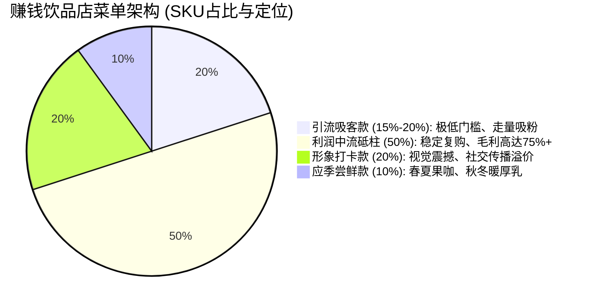

# 爆款菜单设计、外卖命名法与风味文案营销指南

---

## 一、 赚钱菜单的“金字塔”结构法则

很多初创饮品店赚不到钱，是因为菜单品类多而杂，备料损耗大，客单价拉不高。科学的商用饮品菜单建议**总单品数控制在 15~20 款以内**，严格按照“2-5-2-1 金字塔模型”布局：

1. **引流吸客款（2~3款）**：
   - *代表*：暴打香水柠檬茶、经典冰美式。
   - *定价*：¥8.8 ~ ¥9.9（秒杀价/新客专享）。
   - *使命*：冲外卖平台单量与好评数、地摊吸引排队围观。
2. **利润主力军（8~10款）**：
   - *代表*：生椰拿铁、茉莉初雪轻乳茶、多肉葡萄冻冻、经典珍珠奶茶、燕麦拿铁。
   - *定价*：¥14 ~ ¥16。
   - *使命*：贡献全店 70% 的纯利润，原料通用性强，出杯极快（30秒内/杯）。
3. **形象打卡与高溢价款（3~4款）**：
   - *代表*：冰博克 Dirty、幽兰雪顶暴风雪、开心果生酪厚乳。
   - *定价*：¥18 ~ ¥24。
   - *使命*：拉高全店调性与平均客单价，顾客发小红书/朋友圈的免费广告牌。
4. **应季限定款（1~2款，按季轮换）**：
   - *春夏*：鲜榨芭乐青柠冰美式、杨梅冰沙。
   - *秋冬*：烤黑糖栗子热拿铁、肉桂暖香厚热奶。
   - *使命*：激活老客，制造“过季即绝版”的紧迫感。

---

## 二、 爆款饮品的高转化命名法法则

饮品的名字决定了顾客第一眼的点击率与下单冲动。杜绝平淡无奇的命名，运用以下三大爆款公式：

| 命名法则 | 传统平淡命名 (转化低) | 爆款高级感命名 (转化翻倍) | 心理学抓手与卖点 |
| :--- | :--- | :--- | :--- |
| **感官风味具体化** | 茉莉奶茶 | **茉莉初雪 · 栀子花香轻乳茶** | 用“初雪”、“轻乳”暗示轻盈无负担，减脂期女生必点。 |
| **产地与原料背书** | 柠檬乌龙茶 | **暴打潮州鸭屎香 · 香水柠檬茶** | 明确强调原产地（潮州单丛）与现捶动作，突出鲜感。 |
| **情绪与场景共鸣** | 冰拿铁 | **「早八续命」微醺冰博克Dirty** | 直击打工人通勤痛点，制造刚需饮用场景。 |
| **质感与视觉勾勒** | 坚果奶茶 | **幽兰雪顶 · 现烤碧根果云朵茶** | “雪顶”、“云朵”、“现烤”画面感扑面而来，引发拍照欲望。 |

---

## 三、 外卖页面与社交媒体高转化文案模板

### 1. 外卖平台商品详情页“风味风向标”短文案
（复制此模版直接黏贴至美团/饿了么后台商品描述中）：

> 🌿 **【风味雷达】**  
> ▫️ 前调：清晨现摘茉莉的冷冽花香，入口清新扑鼻  
> ▫️ 中调：100% 优质高山牧场鲜乳，丝滑醇润不腻喉  
> ▫️ 尾韵：高山茶多酚带出悠长生津回甘  
> 💡 **【研发主理人贴士】**：精选 0 反式脂肪酸优质轻乳基底，低卡轻负担！推荐【微糖/少冰】，充分领略茶叶原本的花果幽香。

### 2. 朋友圈 / 社群营销发售文案 (限时特惠打法)
> 🔔 **叮！你的午后精神充电宝已上线！**  
> 
> 连续加班昏昏欲睡？来一杯现萃的「生椰拿铁」✨  
> 选用东南亚生椰第一道冷榨原浆，碰撞浓郁坚果调意式精粹浓缩。入口是浓郁的椰香微甜，紧接着是咖啡的醇香暴击！  
> 
> 🛵 今日宠粉福利：  
> 点击下方链接/到店出示本条动态，第二杯立享 **半价**！  
> 数量有限，先到先得～ 🧊☕

---

## 四、 线下摆摊与实体店私域高复购裂变打法

1. **“杯贴码”私域沉淀**：
   - 每只高透杯外侧贴上定制高颜值二维码贴纸：“**扫码进尝鲜群，本单立返 3 元现金红包 / 下次出摊免费领试饮装**”。
   - 将公域散客 100% 转化到微信社群。每天上午 10:30 在群内发龙虎榜预售打折，未出摊单量已锁死。
2. **“集章打孔打卡卡片”**：
   - 随单赠送一张质感牛皮纸复古小卡片：“喝满 5 杯任意款，第 6 杯全场任选免费”。
   - 低成本激发顾客收集癖，极大压制周边竞争对手。
3. **“第二杯半价”凑单策略**：
   - 下午茶多为写字楼办公室拼单场景。设置单杯 ¥16，双杯组合打包 ¥24（单杯折合 ¥12，毛利仍有 65%），轻松促成拼单翻倍出杯。
